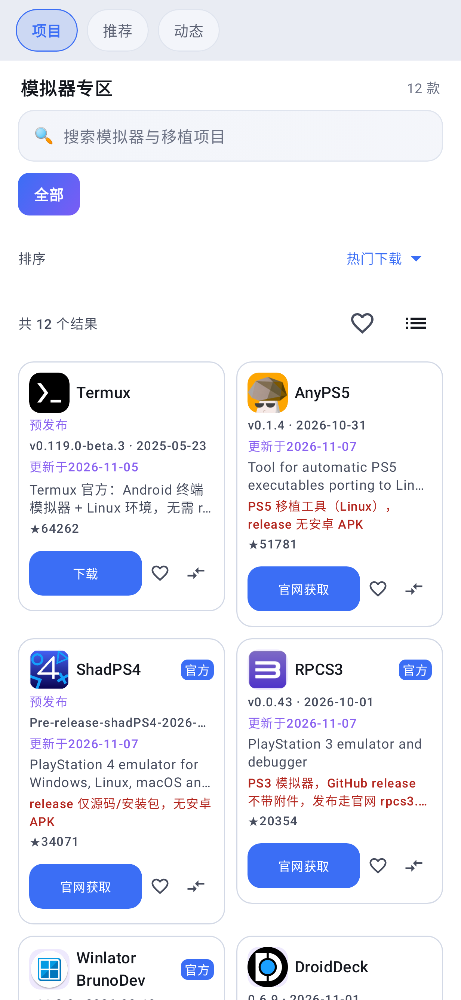
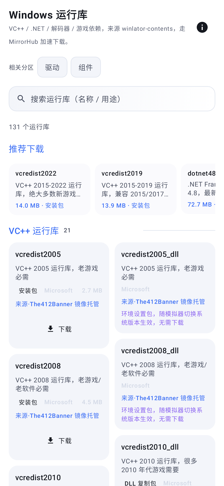
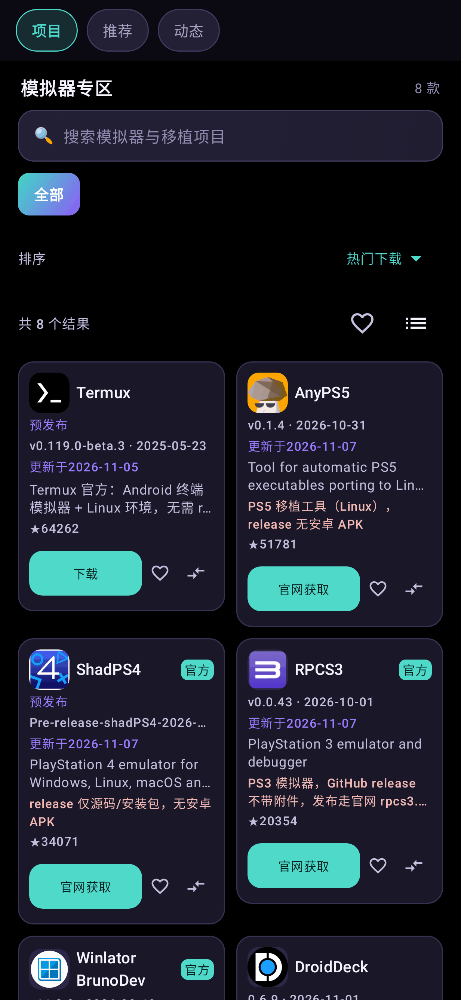

# EmuBox

<div align="center">

[](https://github.com/mihsian77/Emubox/releases)
[](https://afdian.com/a/moon279)

[](LICENSE)
[](https://github.com/mihsian77/Emubox/releases)
[](#功能)

</div>

> 安卓 Windows 模拟环境的驱动、组件与运行库下载管理器。完整中文界面、国内下载加速、按设备自动匹配。

EmuBox 脱胎于 [Rodrig02005/EmuHub-APP](https://github.com/Rodrig02005/EmuHub-APP)（MIT 协议，作者 Rodrigo Castro），在其基础上重做了界面、资源目录与下载链路，面向国内 Winlator / Eden / GameHub 等模拟环境用户。

<p align="center">
  
  
  
</p>

<p align="center"><sub>模拟器库 · 运行库专区 · 深色主题（界面真实渲染，非设计稿）</sub></p>

---

> **官网** — [mihsian77.github.io/Emubox](https://mihsian77.github.io/Emubox/)：功能介绍、界面截图与常见问题。
>
> **不想装 App？** 可用[网页版备选](https://mihsian77.github.io/EmuHub/)（EmuHub 导航站，独立仓库，已归档只读）在浏览器内直接下载常用驱动与组件。网页版功能有限，完整体验请使用 App。

---

## 功能

六个一级入口：首页（设备）· 模拟器 · 驱动 · 运行库 · 资讯 · 我的（下载、设置）。

- **设备页** — 读 GPU 型号、Adreno / Mali 代际、安卓版本与运行内存，按匹配度排出这台机器能用的驱动；同芯片实测给出可玩档位；可在设置关闭，改看全量列表
- **模拟器库** — 数百个模拟器与移植项目的可安装包，按平台、架构、更新状态分类；卡片直接下载，长按看完整文件名与用途
- **驱动专区** — Turnip（高通 Adreno）、PanVK（ARM Mali）、三星 Xclipse 三类 GPU 驱动，按 GPU 家族、架构、型号、目标平台、成熟度分类
- **组件专区** — Wine / Proton、Box64 / FEXCore / WOWBox64、DXVK / VKD3D-Proton / D7VK 等图形与转译组件，聚合多个上游目录
- **运行库专区** — VC++ 运行库、.NET、解码器、字体、DirectX 等 Winlator 常用依赖，附中文用途说明与安装指引
- **资讯** — 上游项目动态按项目聚合，剥掉 HTML 只留正文，不用点进仓库看 release
- **国内下载加速** — 接入 [MirrorHub](https://github.com/mihsian77/MirrorHub) 维护的加速节点，自动测速选优，也可手动切换或关闭
- **下载管理** — 暂停 / 继续 / 断点续传，按类型分目录存放，下载库可扫描本地已有文件、查看包内 `meta.json` 信息
- **组件指南** — 说明每个组件的作用、优先选择、适用场景与切换时机
- **中英双语** — 简体中文 / English，设置内切换

## 下载

从 [Releases](https://github.com/mihsian77/Emubox/releases) 获取最新 APK。

**要求**：Android 9.0（API 28）及以上，**arm64-v8a（64 位）**。安装包只打 64 位架构，32 位机型（armeabi-v7a）没有对应版本，装了会报「应用与设备不兼容」。

想拿最新构建（可能未正式发布）时，直接下 Releases 列表里那条「EmuBox x.y.0（预发布）」——只在维护者打 tag 时更新，不是每次提交都换包。

## 版本

版本分正式版与预发布：

- **正式版** — `x.y.0`（如 1.3.0），`y` 代表功能批次，每完成一批改动定稿发布；带 Latest 徽标。
- **预发布** — 固定 `vx.y.0-pre`（如 `v1.4.0-pre`），整个功能批次只有这一条。只在维护者推 tag 时重建、覆盖同名 APK、刷新日志正文，不新增条目；正式版发布后这条预发布自动删掉。

所以 Releases 列表里正式版随批次累积，预发布始终只有当前这一条。

App 里的版本号形如 `1.4.0-pre.312`（末段是 CI 构建序号，不进 tag）；正式版安装包版本号必定大于同批次任一预发布，可直接覆盖安装。想确认装的是哪一版，看「设置 → 关于」。

## 构建

环境：JDK 17、Android SDK（compileSdk 37、NDK 用于 native Vulkan 采集）。

```bash
git clone https://github.com/mihsian77/Emubox.git
cd Emubox
./gradlew assembleDebug
```

APK 输出于 `app/build/outputs/apk/debug/`。

翻译完整性检查：

```bash
python3 scripts/check-i18n.py
```

检查漏译 / 多译、占位符一致性、空翻译与 Kotlin 硬编码。

改界面时还有三道本地闸门：`scripts/check-copy.py` 查文案规范（中英优先、不写内部视角说明），`scripts/check-truncation.py` 查长字段行数——文件名类字段至少给 3 行，版本号类至少 2 行，`scripts/check-structure.py` 查代码结构——单文件 1500 行、单函数 300 行、未用 import 清零；已超标项记在 `scripts/structure-baseline.json`，只许变小。

## CI

push / PR 到 main 时，`ci.yml` 依次跑 i18n 校验、文案规范、长字段行数闸门、代码结构闸门、Android Lint、单元测试，再编译 Debug / Release，校验 APK 资源完整性；产物只挂在 Actions 的 `emubox-apks` 里，**不发 Release**。对外发布是显式动作：推 `vx.y.0-pre` 触发 `prerelease.yml` 出预发布，推 `v*`（不含 `pre` / `rc`）触发 `release.yml` 出正式版。

发预发布：

```bash
git tag -f v1.4.0-pre && git push -f origin refs/tags/v1.4.0-pre
```

tag 名字不变（整个批次一条 release），强制推送才让内容指向最新提交；普通推送同一个提交不产生事件，也就不会重复发布。以前是每次 push main 都换包，正在下载的人会拼出坏文件。

## 项目结构

```
app/src/main/
├── java/com/emubox/app/
│   ├── MainActivity.kt        # 导航、分区装配、各页数据拉取
│   ├── EmulatorScreen.kt      # 模拟器库：列表、筛选、搜索
│   ├── EmulatorUi.kt          # 模拟器卡片、对比、版本差异
│   ├── EmulatorDetailDialog.kt# 模拟器详情页
│   ├── DriverScreen.kt        # 驱动分区：动态、版本、框架
│   ├── DriverCards.kt         # 驱动卡片、来源选择、更新日志
│   ├── DriverDetectionUi.kt   # 驱动检测、Vulkan 详情、驱动动态
│   ├── DeviceScreen.kt        # 设备检测与驱动推荐
│   ├── DeviceUi.kt            # 设备共用件：品牌标识、路径结论、使用说明
│   ├── ComponentScreens.kt    # 组件分区
│   ├── RuntimeLibraryScreen.kt# 运行库分区
│   ├── DownloadsScreen.kt     # 下载库
│   ├── SettingsScreen.kt      # 设置
│   ├── ComponentGuideScreen.kt# 兼容指南
│   ├── NewsFeedScreen.kt      # 资讯流与全局搜索
│   ├── SocBenchUi.kt          # 芯片知识卡与跑分档位
│   ├── UiFormat.kt            # 通用格式化（时间/体积/头像）
│   ├── SharedUi.kt            # 跨分区共享的搜索框与筛选标签
│   ├── EmulatorRegistry.kt    # 模拟器注册表读取、模型与筛选
│   ├── DownloadService.kt     # 前台下载服务
│   ├── DownloadsManager.kt    # 下载队列、断点续传、本地文件扫描
│   ├── Accelerator.kt         # 加速节点管理、测速、URL 重写
│   ├── HardwareUtils.kt       # 设备硬件识别
│   ├── PlayableCatalog.kt     # 可玩库：同芯片实测与档位
│   ├── NativeVulkanBridge.kt  # Vulkan 采集 / 跑分 JNI 桥
│   ├── RuntimeLibrary.kt      # 运行库目录与中文说明
│   ├── SourceCatalog.kt       # 驱动与组件资源目录
│   └── ui/
│       ├── template/          # 列表型页面模板（搜索栏、分组、空态）
│       └── theme/             # 主题与配色
├── cpp/vulkan_collector.cpp   # native Vulkan 信息采集与基准
└── res/
    ├── values/                # 英文（默认）
    └── values-zh-rCN/         # 简体中文
```

根目录的数据文件由 `scripts/` 下的刷新脚本生成，App 启动时按需拉取；历史版本可能缓存了旧地址，所以文件名与位置保持稳定：

| 文件 | 内容 |
|---|---|
| `data/driver-registry.json` | 驱动条目 |
| `data/emulator-registry.json` | 模拟器条目（列表用） |
| `data/emulator-details-*.json` | 模拟器详情分片，按条目哈希取一片 |
| `data/emulator-ranking.json` | 外部社区排行与趋势 |
| `data/news-data.json` | 资讯聚合 |
| `data/ranking.json` + `data/ranking-history/` | 家族聚合榜，用于网页榜单 |
| `data/speedtest.bin` | 加速节点测速用的固定文件，App 按 URL 直取 |

## 驱动来源

内置驱动注册表按 GPU 家族分类维护：

- **高通 Adreno / Turnip**：覆盖 6xx / 7xx 通用系列与 8xx（含 810 / 812 / 829 / 830 / 840）专属构建
- **ARM Mali / PanVK**：覆盖 Bifrost（G52 / G72）、Valhall v9 / JM（G57 / G77 / G99）、Valhall v10 / CSF（G610 / G615 / G710 / G720）
- **三星 Xclipse（AMD RDNA）**：与上述两家均不兼容，独立分类
- **通用 / 厂商系统驱动**：不绑定具体型号

条数以 [`data/driver-registry.json`](data/driver-registry.json) 为准，随每日数据刷新增减，不在文档里写死。

驱动包标准格式为 zip（adpkg），内含 `meta.json`（名称、版本、厂商、最低 API、驱动库名）与驱动本体 `.so`。注册表随 App 版本更新，来源均为公开开源社区；为避免驱动源被收集滥用，此处不列具体仓库地址。

## 加速说明

App 内所有 GitHub 资源（驱动、组件、运行库、资源目录）的下载均可经加速节点转发。节点数据由 [MirrorHub](https://github.com/mihsian77/MirrorHub)（MIT）维护，定时测速、清理失效节点并按延迟排序；App 启动时拉取最新列表，并内置一批节点作为兜底。

加速模式：**自动**（测速后选最优节点）、**手动**（自行指定节点）、**关闭**（直连）。

二次分发或修改本项目时，请保留 MirrorHub 来源声明。加速节点仅做下载转发，节点本身不作为本项目的收费卖点。

## 参与

清单里的每一条都应该是真的：版本号对、链接能下、分类没错。所以**改对一条数据比加一个功能更有用**。

- 数据错了、链接失效、条目缺失 → 用[数据修正](https://github.com/mihsian77/Emubox/issues/new?template=data_fix.yml)模板，附上项目自己的一手来源链接
- 界面异常、崩溃、下载失败 → 用[报告问题](https://github.com/mihsian77/Emubox/issues/new?template=bug_report.yml)模板，写清机型和系统版本
- 安全漏洞 → **不要开公开 issue**，走[私密报告](https://github.com/mihsian77/Emubox/security/advisories/new)
- 提交代码的规范、构建步骤、不接受的内容 → [CONTRIBUTING.md](CONTRIBUTING.md)

不接受网盘链接、整合包、破解补丁、需要登录才能拿到的东西。

## 开源协议

MIT License。

- 上游 [EmuHub-APP](https://github.com/Rodrig02005/EmuHub-APP)：Rodrigo Castro（Rodrig02005）
- 本项目修改与维护：moon279（mihsian77）
- 加速节点数据：[MirrorHub](https://github.com/mihsian77/MirrorHub)（MIT）

所有驱动、组件与软件的版权归各自作者所有，本项目仅提供下载管理、匹配与加速。二次分发请保留上述来源声明，遵守 MIT 协议。

## 赞助

项目建立在上游开源成果之上。如果它帮到了你，可在[赞助主页](https://mihsian77.github.io/Emubox/sponsor.html)选择平台支持维护，所得用于测试设备与维护投入。

## 致谢

- Rodrigo Castro（Rodrig02005）— EmuHub-APP 作者
- NotZeetaa — EmuHub 原创作者
- MirrorHub 与各公益加速节点运营者
- Mesa / Turnip / PanVK / DXVK / Wine / Box64 等开源项目开发者
